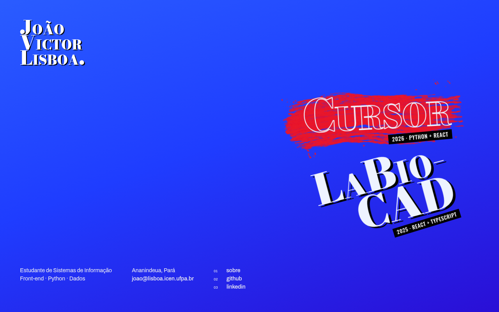

# Portfólio

**Meu portfólio pessoal.** Reúne meus projetos, minha formação e meus contatos em uma única página, feita só com HTML, CSS e JavaScript, sem frameworks e sem etapa de build.

**Acesse:** [joaovictor-rl.github.io/Portfolio](https://joaovictor-rl.github.io/Portfolio/)



**Tecnologias:** HTML · CSS · JavaScript · GitHub Pages

## Estrutura

```
Portfolio/
├── index.html            todo o conteúdo: lista de projetos, nome, informações e painéis
├── assets/
│   ├── css/
│   │   ├── base.css      cores, fontes e regras gerais
│   │   ├── nome.css      nome (topo) e informações (rodapé)
│   │   ├── lista.css     lista de projetos e animação de entrada
│   │   └── projetos.css  painéis que abrem por cima da página
│   ├── js/script.js      abre e fecha os painéis
│   └── img/              ícone e capturas dos projetos
└── docs/                 imagem usada neste README
```
## Inspirações

O layout da página inicial, com os títulos grandes em perspectiva, veio do site do estúdio Van Holtz. A tipografia de capa de revista e as etiquetas pretas inclinadas vieram da estética dos jogos Metaphor: ReFantazio e Persona 5.

---

**João Victor R. Lisboa** · Sistemas de Informação, UFPA · [github.com/joaovictor-rl](https://github.com/joaovictor-rl)
